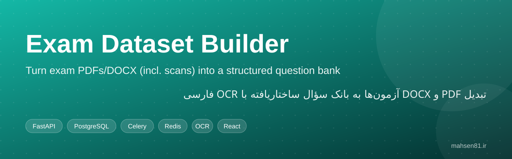

<!-- gen:header -->
<p align="center"></p>

<h1 align="center">Exam Dataset Builder</h1>
<p align="center"><b>تبدیل PDF و DOCX آزمون‌ها به بانک سؤال ساختاریافته با OCR فارسی</b><br><i>Turn exam PDFs/DOCX (incl. scans) into a structured question bank</i></p>
<p align="center">     </p>

<div dir="rtl">

## ✨ امکانات

- OCR محلی Tesseract و پیش‌پردازش تصویر با OpenCV
- تشخیص سؤال، گزینه و پاسخ‌نامه در فارسی و انگلیسی
- داشبورد RTL برای بازبینی و تأیید
- خروجی JSON، CSV و ZIP
- به‌همراه سامانه‌ی آفلاین انبار و کنترل پروژه (anbar)

</div>

## 🚀 Quick start

```bash
copy .env.example .env
docker compose up -d
```

---

<!-- gen:docs -->
## 📚 مستندات کامل · Full documentation

# Exam Dataset Builder

سامانه production-oriented برای تبدیل PDF متنی، PDF اسکن‌شده و DOCX آزمون‌های فارسی/انگلیسی به بانک سؤال ساختاریافته، بازبینی انسانی و خروجی JSON/CSV/ZIP.

## قابلیت‌ها

- آپلود هم‌زمان چند فایل با کنترل حجم، پسوند، signature و سلامت DOCX
- استخراج متن و مختصات PDF با PyMuPDF و OCR محلی Tesseract برای صفحات اسکن‌شده
- deskew، denoise، resize، contrast enhancement و adaptive binarization با OpenCV
- تشخیص صفحه متنی/اسکن، ستون‌ها، زبان غالب، header/footer تکراری و کیفیت پایین
- parser فارسی/انگلیسی برای شماره سؤال، گزینه، متن چندخطی و پاسخ‌نامه انتهای سند
- ذخیره page layout، confidence، raw/normalized text، media و تاریخچه بازبینی در PostgreSQL
- صف Celery/Redis با late acknowledgment، retry/backoff و ثبت failure در DB
- داشبورد RTL برای preview، bounding box، ویرایش، approve/reject، log و export
- خروجی ZIP شامل JSON، CSV، manifest و تصاویر استخراج‌شده
- metrics سازگار با Prometheus و log ساختاریافته JSON

## اجرای سریع

پیش‌نیاز: Docker Desktop با Docker Compose v2.

```powershell
Copy-Item .env.example .env
docker compose up --build
```

فایل `.env` اختیاری است و Compose با مقادیر توسعه پیش‌فرض نیز بالا می‌آید. برای هر محیط اشتراکی حتماً رمزهای PostgreSQL و MinIO را تغییر دهید.

| سرویس | آدرس |
|---|---|
| داشبورد | http://localhost:3000 |
| OpenAPI | http://localhost:8000/docs |
| Health | http://localhost:8000/health |
| Metrics | http://localhost:8000/metrics |
| MinIO Console | http://localhost:9001 |

پس از بالا آمدن سرویس‌ها، فایل را در داشبورد بارگذاری کنید و دکمه شروع پردازش را بزنید. worker سند را از MinIO می‌خواند، نتیجه را در PostgreSQL می‌نویسد و وضعیت UI به‌صورت polling به‌روز می‌شود.

## فرمان‌های عملیاتی

```powershell
# وضعیت و logها
docker compose ps
docker compose logs -f api worker

# migration
docker compose run --rm migrate alembic upgrade head
docker compose run --rm migrate alembic downgrade -1

# ساخت یا به‌روزرسانی کاربر بازبین
docker compose run --rm api python -m apps.api.seed_admin --email reviewer@example.com --password StrongPass123 --name "Reviewer One"

# کل تست‌ها روی PostgreSQL واقعی
docker compose --profile test run --rm tests

# تست‌های واحد محلی
python -m pip install -e ".[dev]"
python -m pytest tests/unit
ruff check apps packages tests
mypy packages/exam_builder

# build مستقل frontend
Set-Location apps/web
npm install
npm run build
```

## نمونه API

```bash
curl -F "files=@exam.pdf" -F "files=@answer-key.docx" http://localhost:8000/uploads
curl -X POST http://localhost:8000/documents/DOCUMENT_UUID/process
curl "http://localhost:8000/questions?document_id=DOCUMENT_UUID&review_status=needs_review&page_size=50"
curl -X POST -H "Content-Type: application/json" \
  -d '{"format":"zip","document_id":"DOCUMENT_UUID"}' \
  http://localhost:8000/exports

curl -X POST -H "Content-Type: application/json" \
  -d '{"email":"reviewer@example.com","password":"StrongPass123"}' \
  http://localhost:8000/auth/login
```

PATCH سؤال از optimistic concurrency استفاده می‌کند؛ مقدار `expected_version` باید با نسخه فعلی سؤال برابر باشد، وگرنه API کد `409` برمی‌گرداند.

## ساختار repository

```text
apps/api/                 FastAPI و endpointها
apps/web/                 Next.js App Router و داشبورد RTL
packages/exam_builder/    مدل، pipeline، OCR، parsing، storage و exporter
migrations/               تاریخچه Alembic
tests/unit/               تست‌های سریع و مستقل
tests/integration/        PostgreSQL pipeline و API
docker/                   imageهای Python و Next.js
docs/                     معماری، API و عملیات
```

## تنظیمات مهم

تمام متغیرها در [.env.example](.env.example) مستند شده‌اند. متغیرهای کلیدی:

- `DATABASE_URL`: اتصال SQLAlchemy/psycopg
- `CELERY_BROKER_URL`, `CELERY_RESULT_BACKEND`: Redis
- `S3_*`: MinIO یا هر storage سازگار با S3
- `MAX_UPLOAD_MB`: سقف هر فایل
- `OCR_PROVIDER`: مقدار `tesseract` یا `http`
- `OCR_LANGUAGES`: پیش‌فرض `fas+eng`
- `OCR_EXTERNAL_URL`, `OCR_EXTERNAL_TOKEN`: adapter خارجی اختیاری

## مستندات بیشتر

- [معماری و جریان داده](docs/architecture.md)
- [API و مدل داده](docs/api.md)
- [OCR، Layout و محدودیت دقت](docs/ocr-and-limitations.md)
- [عملیات و رفع خطا](docs/operations.md)

## امنیت production

این repository احراز هویت application-level را فعال نمی‌کند تا با SSO/OIDC سازمان مقصد تداخل نداشته باشد. پیش از دسترسی اینترنتی، API و UI را پشت reverse proxy دارای TLS و OIDC قرار دهید، CORS را محدود کنید، secretها را در secret manager نگه دارید و دسترسی MinIO console را عمومی نکنید. مدل `User` و `user_id`های audit برای اتصال identity provider آماده‌اند.

---

<p align="center">ساخته‌شده توسط <a href="https://mahsen81.ir"><b>محسن جباره‌اصل</b></a> — برنامه‌نویسی، طراحی سایت، ربات و هوش مصنوعی<br>
Built by <a href="https://mahsen81.ir">Mohsen Jabbareh-Asl</a> · ⭐ اگر مفید بود، ستاره بدهید · Need a custom version? <a href="https://mahsen81.ir">Get in touch</a></p>
