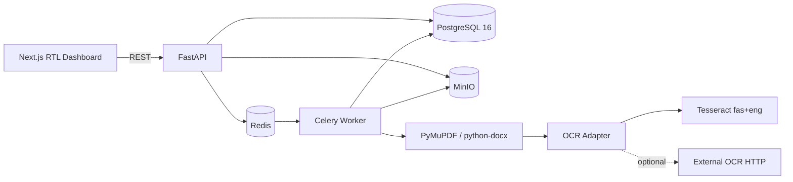

# معماری

## اجزا

API فقط کارهای کوتاه، validation، query و mutation بازبینی را انجام می‌دهد. پردازش سند و export در queueهای `documents` و `exports` اجرا می‌شوند. PostgreSQL منبع اصلی وضعیت و داده ساختاریافته است؛ Redis فقط broker/result backend و MinIO فقط binary object store است.

## جریان پردازش

1. API پسوند، magic bytes، اندازه و archive داخلی DOCX را بررسی می‌کند.
2. فایل خام با کلید UUID در MinIO و metadata/checksum در PostgreSQL ثبت می‌شود.
3. endpoint پردازش وضعیت را به `queued` تغییر می‌دهد و task را dispatch می‌کند.
4. worker برای PDF، بلوک‌های متن/مختصات و image xrefها را با PyMuPDF می‌گیرد.
5. صفحه کم‌متن به تصویر 180 DPI تبدیل و پس از preprocessing به OCR adapter داده می‌شود.
6. header/footer تکراری حذف، ستون‌ها و ترتیب خواندن RTL تعیین می‌شوند.
7. parser سؤال، گزینه، پاسخ‌نامه و confidence را می‌سازد.
8. page، question، option، answer key و media در یک transaction نوشته می‌شوند.
9. سؤال‌های confidence پایین با وضعیت `needs_review` در داشبورد دیده می‌شوند.
10. هر edit/approve/reject یک `ReviewAction` با before/after snapshot ایجاد می‌کند.
11. export از query DB ساخته و binary حاصل در MinIO ذخیره می‌شود.

## سازگاری و توسعه

- مدل‌های SQLAlchemy از API مستقل‌اند و migrationها snapshot صریح schema هستند.
- موتور extraction dataclassهای مستقل برمی‌گرداند و به FastAPI/Celery وابسته نیست.
- OCR از `Protocol` استفاده می‌کند؛ adapter جدید بدون تغییر parser قابل افزودن است.
- storage با API استاندارد S3 کار می‌کند و MinIO قابل جایگزینی با AWS S3 است.
- `version` سؤال جلوی overwrite هم‌زمان دو reviewer را می‌گیرد.

## وضعیت و failure

چرخه عادی `pending → queued → processing → completed` است. خطاهای connection/OSError سه بار با exponential backoff retry می‌شوند. خطای نهایی وضعیت document/upload را `failed` می‌کند، error code/message و `ProcessingLog` ثبت می‌شود و فایل خام برای reprocess باقی می‌ماند.
